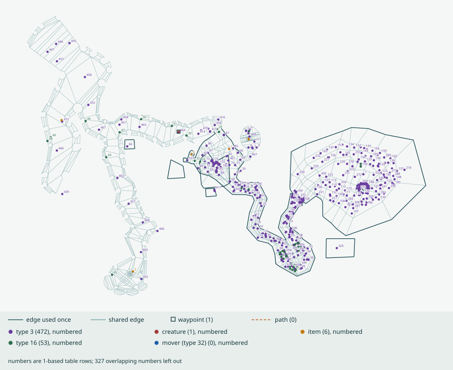

# Lands of Lore III: file formats and game data

*Lands of Lore III* is a first-person role-playing game by Westwood Studios (1999). This repository documents what is known about its original data files and gives you Python tools that read them from your own copy of the game.

It contains documentation, tools and small diagrams. It contains no game files and no extracted game pictures, sounds, movies or text.

## At a glance

- **What this is:** documentation of the original 1999 Windows game's data files and engine, checked against the game files and the original program `LOL3.DAT`. It is less complete than the LoL1 and LoL2 repositories.
- **What you can do today:** unpack every archive the game ships with, read level geometry, light maps and scripts, export textures to PNG (after running the game once, which writes its texture cache), check movies, music and sounds, draw a level outline, and follow one level event from entry to effect.
- **Start in five minutes:** the [Quick start](#quick-start) below, then [Start here, by goal](docs/START_HERE.md), [How the game works](docs/HOW_THE_GAME_WORKS.md) or the [worked example](docs/tutorial-one-event.md).
- **What is still unknown:** the [open questions](docs/OPEN_QUESTIONS.md), counted in the [rating](#rating). Open points include most item effects, how an item picked up from the floor is stored in a save, and some display settings; two answers were checked on one display setting only. Some questions can only be settled by watching the [original game run](docs/NEEDS_A_RUNNING_GAME.md); the texture and movie colour formats were settled that way, and the rest need saved games from later in the game.
- **What changed lately:** [what's new](docs/WHATS_NEW.md), newest first.
- **The three games:** [LoL1](https://github.com/KForestland/lands-of-lore-1-re) · [LoL2](https://github.com/KForestland/lands-of-lore-2-re) · [LoL3](https://github.com/KForestland/Lands-of-lore-3-re) ([what they share](docs/series-formats.md), [how the engine changed](docs/engine-evolution.md)).

## Rating

These are counts of work done, not a percentage of how complete the project is. Every page says what was measured, which program address or file offset proves it (CONFIRMED) or what is still a reading (UNCONFIRMED), and what would settle the rest. The lines are produced by `tools/rating.py` on the English GOG copy; [how we rate](docs/HOW_WE_RATE.md) explains each line and what it does not claim.

<!-- rating:begin -->
- **Files read:** 51 of 56 files in `DAT` (2,306.1 of 2,574.4 MiB) have their whole layout read by a tool here: every byte belongs to a known header, directory or entry (what is inside an entry may still be only partly understood). 5 more (268.3 MiB: the four `.PHT` files and the shipped `cdcache.wsx`) are shown byte for byte to be one block repeated; what those bytes mean and what reads them is unknown.
- **Rules traced:** the pages mark 289 statements CONFIRMED (proved from the program code or the files) and 60 UNCONFIRMED (a reading not yet proved), on 73 current pages; old notes kept as history are not counted.
- **Seen in the running game:** 3 of 5 questions that can only be settled by watching the original game run are settled.
- **Open questions:** 13 numbered questions: 3 answered, 6 mostly answered, 4 partly answered.
<!-- rating:end -->



The level QWOD0 seen from above, drawn from its map file: each line is an edge of a surface in the level geometry; dark edges belong to one surface, pale edges are shared by several. Heights are not drawn. [MAP evidence and drawing command](docs/formats/map-odf.md#overhead-schematic).

## What you get

- **Format pages** in [`docs/formats/`](docs/formats): [WSX](docs/formats/wsx.md), [LMF](docs/formats/lmf.md), [MAP and ODF](docs/formats/map-odf.md), [textures](docs/formats/textures.md), [PHT](docs/formats/pht.md), each with a worked example from the game files.
- **Level sheets** in [`docs/levels/`](docs/levels/README.md): one per level, generated from the archives.
- **Program pages** in [`docs/`](docs/README.md): how the game program `LOL3.DAT` itself reads archives, light maps, textures, maps, scripts, items, spells, dialogue, combat and saves.
- **Tools** in [`tools/`](tools/README.md): readers and checks for every format above, a texture-to-PNG exporter, a level drawer, a save-header reader and the level-sheet and script-notes writers; `check_all.py` runs all twenty-one checks.
- **Script summaries** in [`docs/levels/notes/`](docs/levels/notes/README.md): per level, counts of triggers, effects and targets, with one worked excerpt.
- **Guides:**
  - [Start here, by goal](docs/START_HERE.md)
  - [glossary](docs/GLOSSARY.md)
  - [open questions](docs/OPEN_QUESTIONS.md)

## Quick start

You need Python 3.8+ and your own copy of the game: the English GOG release (the script check pins `LOL3.DAT` by its hash). Start the game once before using the tools, so it writes its texture cache; without it, 3 of the 21 checks are skipped. Optional: the system LZO library (`apt install liblzo2-2`) for the `--decode` checks.

The tools read the `DAT/` folder and two files in the game folder above it:
- `LOL3.DAT`, the game program (a 1.6 MB Windows PE file; `LOL3.EXE` is only a small launcher);
- `cdcache.wsx`, a large cache the game writes when it runs. The three cache texture checks report SKIP if it is missing.

The duplicate copies of `LOCAL.WSX` and `locallng.wsx` next to `LOL3.DAT` are not read by the tools (the copies in `DAT/` are).

```bash
git clone https://github.com/KForestland/Lands-of-lore-3-re.git
cd Lands-of-lore-3-re
export LOL3_DAT=/path/to/your/LoL3/DAT      # the game's DAT folder
python3 tools/check_all.py                  # 21 checks, ends with ALL 21 CHECKS PASSED (or 18 passed, 3 skipped if the game has never run)
python3 tools/extract_wsx_entries.py --data "$LOL3_DAT" --check
python3 tools/lol3_script_notes.py --data "$LOL3_DAT" --out ../lol3-notes   # full script listings, outside the repository
```

The script check prints, for example:

```text
CHECK script_notes: 18 level summaries, 54,940 object and 4,040 region records, 16,876/2,201 direct object/region references
```

The `--out` folder then holds one listing per level: every script record with its file offset, opcode, operands and the native effect, for your own copy only.

## Status

Full table with evidence: [`docs/STATUS.md`](docs/STATUS.md). "Q11" and the like are numbered questions in [`docs/OPEN_QUESTIONS.md`](docs/OPEN_QUESTIONS.md).

| Area | State |
|------|-------|
| WSX archives | Layout documented; all 51 shipped WSX archives in `DAT/` parse; the 52nd, `cdcache.wsx`, does not parse as an archive. Its body is 51 copies of one block, listed separately in the rating (Q1: what writes the block) |
| Loose PHT files | Four files, each a prefix of one repeating block, listed separately in the rating ([PHT](docs/formats/pht.md)). What the bytes mean and what reads them is open |
| LMF light maps | The native directory yields 5,256 stored groups and 424,288 members in 18 entries ([LMF](docs/formats/lmf.md), Q3). |
| MAP, ODF | Header, section 1, waypoints, paths, surfaces and the ODF type-tagged definitions (334) read through the native readers. Section-1 bytes each have a reader; waypoint byte +6, the label spans and the bytes before field 16 are measured (Q4, Q5 mostly) |
| Textures | [Cache to PNG](docs/lol3-texture-bake.md#cache-record-to-png): 10,669 of 15,118 mip records in the game-written cache decode using native palette sources; six flag values need further work. All 18 `.TE_` wrappers decode (Q1, Q6, Q7). |
| Movies, music | Movie files (VQA) decoded; on a 16-bit display under Wine the intro's colours are converted from 15-bit to 16-bit (Q9); the 38 music tracks are MP3 inside WAV files, played through the Miles sound library (Q10) |
| Level sounds | WAV files using IMA ADPCM compression, in the 18 per-level sound archives ([level sheets](docs/levels/README.md)) |
| Scripts | All 18 levels' scripts frame exactly with the 39 native opcode lengths; every opcode, event pool, predicate and timer formula traced, the object commands resolved per target class (only the on-screen look of effect objects is open); per-level summaries (Q11) |
| Items, spells, dialogue, combat | Traced in the program: 343 item rows, fourteen regular item handlers, 28 spell definitions, the dialogue and quest tag lookup (2,641 of 2,642 commands join), the creature hit resolver, cast cost and mana debit. Open: most per-item effects and mitigation names (Q12) |
| Saves | Header, directories and compression mapped from 47 of our own saved games, written by the original program (not included, so no tool here can re-check them); a running-game comparison isolates the fields of a turn, a step and an item move; other payload meanings open (Q13) |

## Repository layout

- [`docs/`](docs/README.md): format pages, program pages, status, open questions, glossary. Older checkpoint notes are kept as history and marked so.
- [`docs/levels/`](docs/levels/README.md): one sheet per level; [`docs/levels/notes/`](docs/levels/notes/README.md): script summaries.
- [`tools/`](tools/README.md): readers and checks.
- [`evidence/`](evidence): lists of program addresses and files that back up the pages.
- [`examples/`](examples/README.md): no images now; it says where the one level drawing comes from and how it is checked.

## Asset policy

No game files and no dumps of extracted game media are included; short byte excerpts appear in the documentation as examples. `tools/check_all.py` includes `repo_guard.py`, which fails on:
- a committed game file, media file or stray image;
- a file over 300 KB or a generated script listing;
- a machine path, or a word from an optional local word list (`.git/info/private_words`, never tracked).

The release procedure also checks every commit identity (`repo_guard.py --check --release`, see [CONTRIBUTING](CONTRIBUTING.md)).

## The other Lands of Lore games

Formats the three games share, with links to the LoL1 and LoL2 repositories: [docs/series-formats.md](docs/series-formats.md).

## Sources

Facts are checked against the original files and the original program (`LOL3.DAT`), with addresses or file offsets cited on each page. This is independent documentation. See [`CONTRIBUTING.md`](CONTRIBUTING.md) to help.
