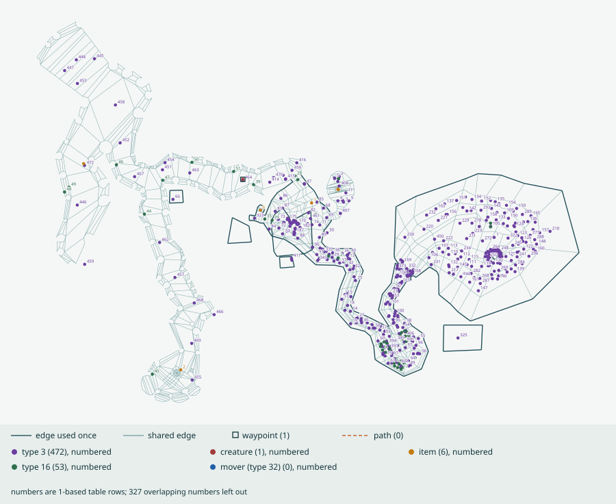

# Follow LoL3 QWOD0 from map to exit

QWOD0 has an overhead plan, two commands that can request the next level, and one creature placement. Follow those three records from the picture and tables to the original bytes.



## Draw the surface edges and write the sheet

```bash
export LOL3_DAT=/path/to/your/LoL3/DAT
mkdir -p ../lol3-tour
python3 tools/lol3_level_schematic.py --level QWOD0 --out ../lol3-tour/qwod0.svg
python3 tools/lol3_level_report.py --out ../lol3-tour/levels
```

**CONFIRMED.** The MAP at `QWOD0.WSX+0x72E28B` contains 1,308 vertices and 1,430 surfaces. The drawing plots shared and single-use edges, one waypoint square and dots for the placement rows. Dot labels are one-based row numbers, with crowded labels omitted. The same archive holds the texture, light map and object definitions. [QWOD0 sheet](levels/QWOD0.md) · [Native level loader](HOW_A_LEVEL_IS_PUT_TOGETHER.md)

## Follow the portal to BUPP1

```bash
python3 tools/lol3_progression.py --out ../lol3-tour/progression.md
python3 tools/lol3_script_browser.py QWOD0 --out ../lol3-tour/opcodes.txt
python3 -c 'import os; d = open(os.environ["LOL3_DAT"] + "/QWOD0.WSX", "rb").read(); [print(hex(o), d[o:o + 6].hex(" ")) for o in (0x74BE4B, 0x74BE7B)]'
```

The browser line is a tally by opcode: it counts 11 opcode-0x02 commands in the object stream but does not list them. The progression page picks out the two that are portals, and the last line reads their bytes from the archive.

**CONFIRMED.** The commands at offsets 194 and 242, in groups 176 and 230, have the same six bytes `02 01 00 00 1B 20` at `QWOD0.WSX+0x74BE4B` and `+0x74BE7B`. Subcommand 27 reaches the native portal arm at `0x410F98`. Both commands request BUPP1 with arrival argument 1. The kind-6 event for group 176 checks object byte +0x31 for zero. Group 230 has a kind-22 name match and no local predicate. **UNCONFIRMED.** Trace the sender for that name match to establish when group 230 can run. [QWOD0 portal rows](PROGRESSION.md#level-qwod0) · [Native object event dispatch](lol3-object-dispatch.md)

## Join the creature dot to its definition

```bash
python3 tools/lol3_numbers.py --out ../lol3-tour/numbers.md
```

**CONFIRMED.** The single creature placement is at `QWOD0.WSX+0x7515BD`, where the first two words store X 11063 and Z −2943. The loader at `0x4B454F–0x4B4557` reads the 56-byte row. At `0x4B4579–0x4B459F` it takes byte +0x20 and multiplies it by 139 for the runtime definition stride. The byte is zero, selecting ODF slot 0. The corresponding disk definition at `QWOD0.WSX+0x778124` supplies an HP cap of 25 and attack input +0x81 of 5. The setup uses half that attack input, rounded down to 2, before further adjustments. [Placement fields](formats/map-odf.md) · [Creature definitions and attack formula](NUMBERS.md#creature-definitions-by-level-field-3-type-rows-not-placements-a-few-tags-are-objects)
